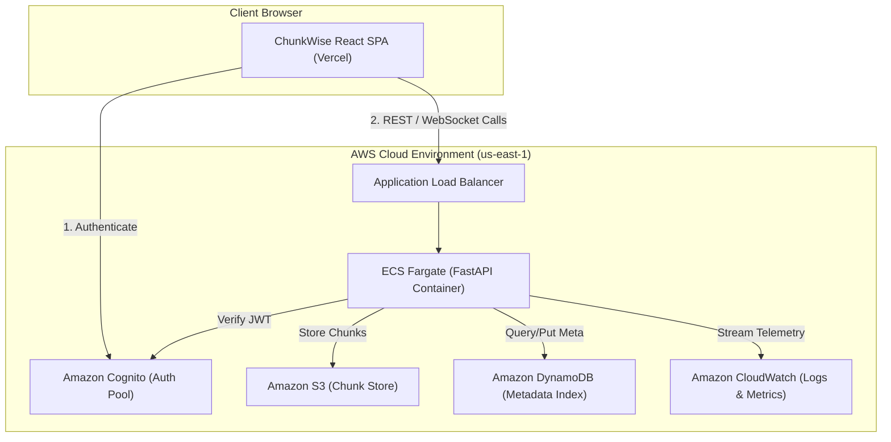

# Implementation Plan for ChunkWise Project

---

## Team Roster and Core Responsibilities

- **Poorvaja (Frontend Lead & Compression Specialist)**:
  - Lead UI/UX Design System (Warm Ivory palette, responsive SaaS layout).
  - Web Application Architecture (Sidebar, Overview, Chunk Explorer, Storage Analytics).
  - Interactive Simulation Engine (10-stage visual pipeline with animated flow arrows and branching).
  - Compression Layer (zlib integration, post-dedup compression decision, uncompressed hashing, chunk restore decompression).
  - UI-side authentication integration and frontend testing (Cypress/Jest).

- **Bhoomi (Backend Architect & Cloud Specialist)**:
  - Windows Reparse Points Handling (`pywin32` detection, symlinks, directory junctions, path traversal safety).
  - Optimization Policy Framework (Dynamic JSON policies in DynamoDB, Balanced/Space Saver/Fast Restore presets).
  - Backend API extensions and DynamoDB metadata schema updates (`codec`, `stored_size`, `reparse_info`, `policy_version`).
  - Cloud Deployment (ECS Fargate containerization, DynamoDB/S3 IAM policies, Cognito User Pool setup).
  - Performance Benchmarking suite (10 GB dataset metrics) and backend test suite (`pytest`).

---

## Table of Contents
1. [Executive Summary](#1-executive-summary)
2. [Current Architecture and Codebase Audit](#2-current-architecture-and-codebase-audit)
3. [Professor's Additional Requirements](#3-professors-additional-requirements)
   - [A. Compression Layer (Owner: Poorvaja)](#a-compression-layer-owner-poorvaja)
   - [B. Improved GUI (Owner: Poorvaja)](#b-improved-gui-owner-poorvaja)
   - [C. Reparse Point Handling (Owner: Bhoomi)](#c-reparse-point-handling-owner-bhoomi)
   - [D. Optimization Policies (Owner: Bhoomi)](#d-optimization-policies-owner-bhoomi)
4. [Detailed UI/UX Design and Information Architecture (Lead: Poorvaja)](#4-detailed-uiux-design-and-information-architecture-lead-poorvaja)
   - [Visual Design System](#visual-design-system)
   - [Sidebar Navigation](#sidebar-navigation)
   - [Interactive Simulation UI](#interactive-simulation-ui)
   - [Human-Centric Information Display](#human-centric-information-display)
5. [Authentication Strategy (Joint: Poorvaja & Bhoomi)](#5-authentication-strategy-joint-poorvaja--bhoomi)
6. [Backend Architecture and Schema Extensions](#6-backend-architecture-and-schema-extensions)
   - [Compression Service (Owner: Poorvaja)](#compression-service-owner-poorvaja)
   - [Reparse Point Service (Owner: Bhoomi)](#reparse-point-service-owner-bhoomi)
   - [Policy Management API (Owner: Bhoomi)](#policy-management-api-owner-bhoomi)
   - [DynamoDB Schema Changes (Owner: Bhoomi)](#dynamodb-schema-changes-owner-bhoomi)
   - [Error Handling and Safety Invariants](#error-handling-and-safety-invariants)
7. [Deployment Architecture (Lead: Bhoomi, UI: Poorvaja)](#7-deployment-architecture-lead-bhoomi-ui-poorvaja)
8. [Testing and Benchmarking Plan](#8-testing-and-benchmarking-plan)
   - [Backend Unit and Integration Tests (Owner: Bhoomi)](#backend-unit-and-integration-tests-owner-bhoomi)
   - [Frontend Component and End-to-End Tests (Owner: Poorvaja)](#frontend-component-and-end-to-end-tests-owner-poorvaja)
   - [Empirical Performance Benchmarks (Joint: Poorvaja & Bhoomi)](#empirical-performance-benchmarks-joint-poorvaja--bhoomi)
9. [Member-wise Work Division and 5-Week Timeline](#9-member-wise-work-division-and-5-week-timeline)
10. [Demo and Viva Defense Plan](#10-demo-and-viva-defense-plan)
11. [Risk Matrix and Mitigation Strategies](#11-risk-matrix-and-mitigation-strategies)
12. [Future Improvements](#12-future-improvements)

---

## 1. Executive Summary

ChunkWise is a chunk-level deduplication and cloud storage optimization platform designed for modern file workflows. The existing core system uses Rabin-based Content Defined Chunking (CDC) to identify variable-length chunk boundaries and SHA-256 cryptographic hashes for chunk addressing, backed by Amazon S3 for chunk content and Amazon DynamoDB for metadata indexing.

To satisfy the four extensions specified by the professor and deliver a production-grade capstone project, this plan defines the technical roadmap for:
1. **Compression Layer**: Integrating an adaptive zlib compression pipeline that operates strictly post-deduplication, guaranteeing chunk immutability and preventing redundant CPU expenditure.
2. **Improved GUI**: Transforming the user experience into a polished, light-themed SaaS dashboard using a Warm Ivory aesthetic and building an interactive 10-stage deduplication simulation.
3. **Reparse Point Handling**: Introducing a safe filesystem scanner for Windows NTFS symbolic links, directory junctions, and mount points to prevent infinite traversal and path traversal exploits.
4. **Optimization Policies**: Developing configurable storage/performance trade-off profiles (Balanced, Space Saver, Fast Restore) with measurable benchmark validations.

The workload is divided equitably between **Poorvaja** (Frontend Lead & Compression Pipeline) and **Bhoomi** (Backend Architecture & Reparse Points/Policy Engine).

---

## 2. Current Architecture and Codebase Audit

### 2.1 Existing Modules
- `src/chunkwise/chunker.py`:
  - Implements Rabin CDC with parameters:
    - Minimum chunk size: 2 KB (2,048 bytes).
    - Average target chunk size: 8 KB (8,192 bytes).
    - Maximum chunk size: 64 KB (65,536 bytes).
    - Rolling window size: 48 bytes.
    - Boundary mask: `0x1FFF` (8,191).
    - Boundary trigger: `size >= max_size or (size >= min_size and (fingerprint & 8191) == 0)`.
  - Also contains fixed-size chunking fallback with final short chunk handling.
- `src/chunkwise/engine.py`:
  - Coordinates end-to-end file upload and download operations.
  - Generates SHA-256 for chunk identity: `hashlib.sha256(chunk_bytes).hexdigest()`.
  - Performs deduplication lookup against DynamoDB `ChunkMeta` table.
- `src/chunkwise/store.py`:
  - Wraps S3 client operations (`put_object`, `get_object`, key schema `objects/{prefix}/{hash}`).
  - Manages DynamoDB tables (`chunkwise-chunks`, `chunkwise-files`).
- `src/chunkwise/http_api.py`:
  - FastAPI application exposing endpoints for file upload, retrieval, and status.
- `tests/`:
  - 72 passing test cases verifying chunker boundary conditions, deduplication counts, and S3 mock integration.

### 2.2 Critical Invariants to Preserve
- **Chunk Identity**: The SHA-256 digest must ALWAYS be computed over the raw uncompressed bytes. Compression must never mutate the chunk hash.
- **Backward Compatibility**: Existing uncompressed chunks stored in S3 must remain restorable without corruption.
- **Two-Phase Commit**: Chunks must be safely committed to S3 prior to creating metadata records in DynamoDB to eliminate orphan metadata pointers.

---

## 3. Professor's Additional Requirements

### A. Compression Layer (Owner: Poorvaja)

#### Technical Rationale: Why Compress After Deduplication?
1. **Hashing Invariance**: Deduplication relies on content hash equality. Two identical files must yield identical chunk hashes regardless of the compression algorithm or compression level applied.
2. **Eliminating Redundant CPU Work**: In a deduplicated system, a large percentage of chunks already exist in storage. Compressing every chunk before querying DynamoDB would waste CPU cycles compressing data that will immediately be discarded.
3. **Adaptive Decision**: Compressing after lookup allows ChunkWise to compress only genuinely new, unique chunks.

```
Incoming File Chunk
        |
        v
Compute SHA-256 on Raw Bytes (Hash = H)
        |
        v
Query DynamoDB for Hash H
        |
  +-----+-----+
  |           |
Found?      New?
  |           |
  v           v
Reuse Chunk  Run zlib.compress(chunk, level)
             Calculate: savings = 1 - (len(compressed) / len(raw))
             If savings >= threshold:
                 Store Compressed Bytes in S3 (codec='zlib')
             Else:
                 Store Raw Bytes in S3 (codec='none')
             Write Metadata to DynamoDB
```

#### Policy Profiles
| Profile Name | zlib Level | Min Savings Threshold | Target Workload |
|--------------|------------|-----------------------|-----------------|
| **Balanced** | 6 | 5% | General documents, mixed archives |
| **Space Saver** | 9 | 2% | Large backups, high-latency/metered storage |
| **Fast Restore** | 1 | 10% | Frequent access files, latency-sensitive reads |

#### Restoration Pipeline
- Retrieve chunk from S3 using key `objects/{hash[:2]}/{hash}`.
- Inspect `codec` attribute in `ChunkMeta`:
  - If `codec == 'zlib'`: Decompress using `zlib.decompress()`.
  - If `codec == 'none'`: Use bytes directly.
- Recompute SHA-256 on decompressed bytes and assert equality with chunk hash. If mismatched, raise `CorruptChunkError`.

---

### B. Improved GUI (Owner: Poorvaja)

#### Visual Theme & Palette
The interface is strictly light-themed, modern, and aligned with enterprise SaaS aesthetics.

| Color Name | Hex Code | Role in Interface |
|------------|----------|-------------------|
| **Warm Ivory** | `#F5F3EE` | Main background canvas, page backdrop |
| **White** | `#FFFFFF` | Primary card surfaces, modal sheets |
| **Deep Slate** | `#263746` | Primary typography, headers, active icon fills |
| **Muted Terracotta**| `#D47D70` | Primary action buttons, active sidebar pill, highlights |
| **Sage** | `#8FA69A` | Success indicators, verified checkmarks, dedup badge |
| **Dusty Blue** | `#8DA7B8` | Storage metrics, secondary graph accents, progress bars |
| **Warm Grey** | `#E7E3DC` | Subtle borders, table dividers, card outlines |
| **Slate Grey** | `#697782` | Secondary labels, timestamps, descriptive subtitles |

---

### C. Reparse Point Handling (Owner: Bhoomi)

#### Scope & Windows Specifics
On Windows NTFS, reparse points implement Symbolic Links (`IO_REPARSE_TAG_SYMLINK`), Directory Junctions (`IO_REPARSE_TAG_MOUNT_POINT`), and Volume Mount Points.

#### Ingestion Rules (Safety First)
1. **Detection Before Traversal**: Check `os.lstat(path)` for `stat.FILE_ATTRIBUTE_REPARSE_POINT` using `pywin32` APIs (`GetFileInformationByHandleEx`).
2. **Never Follow Recursively by Default**: Treat reparse points as atomic metadata entries. Do not traverse into link target directories during whole-folder uploads.
3. **Capture Metadata Object**:
   - `is_reparse`: `true`
   - `tag_type`: `symlink` | `junction` | `mount_point` | `unknown`
   - `target_path`: String representation of target (relative or absolute)
   - `is_directory`: Boolean flag

#### Restoration Safety
1. **Explicit Toggle**: Links are only recreated if `restore_links=true` is passed by user.
2. **Path Traversal Guard**: If a relative link resolves to a path outside the destination root (`../..`), refuse link creation and record a security warning.
3. **Junction vs Symlink Separation**:
   - Directory Junctions are restored using NTFS junction creation (`CreateVolumeMountPointW` or `mklink /J`).
   - Symlinks require elevated privileges or Windows Developer Mode; if creation fails with `ERROR_PRIVILEGE_NOT_HELD`, gracefully fall back to creating a text stub `.link_info.json` explaining the link target.

---

### D. Optimization Policies (Owner: Bhoomi)

#### Policy Definition Schema
Optimization policies govern the compression parameters and storage behavior across upload tasks.

```json
{
  "policy_id": "policy_balanced_v1",
  "name": "Balanced",
  "description": "Standard trade-off between CPU consumption and storage footprint.",
  "compression": {
    "enabled": true,
    "codec": "zlib",
    "level": 6,
    "min_saving_ratio": 0.05
  },
  "chunking": {
    "min_kb": 2,
    "avg_kb": 8,
    "max_kb": 64
  },
  "reparse_policy": {
    "record_only": true,
    "allow_link_traversal": false
  },
  "concurrency": {
    "upload_threads": 4
  }
}
```

#### Application Rules
- **Non-Retroactive**: Modifying an optimization policy applies strictly to future file uploads. Existing chunks in S3 remain untouched.
- **Auditability**: Every uploaded file record in DynamoDB stores the active `policy_id` under which it was processed.

---

## 4. Detailed UI/UX Design and Information Architecture (Lead: Poorvaja)

### Visual Design System
- **Typography**: Inter (System fallback: Segoe UI, Roboto). Clear 600 weight for headings, 400 for body, 500 for metrics.
- **Card Containers**: Background `#FFFFFF`, 1px border `#E7E3DC`, border-radius 8px, soft drop-shadow `0 2px 6px rgba(38, 55, 70, 0.04)`.
- **Buttons**:
  - Primary: Background `#D47D70`, text `#FFFFFF`, rounded 6px, hover brightness 95%.
  - Secondary: Background `#FFFFFF`, border 1px solid `#E7E3DC`, text `#263746`.

### Sidebar Navigation
A clean, fixed-width (240px) sidebar with the Deep Slate and Warm Ivory background:
1. **Brand Header**: ChunkWise logo mark + project status pill (`Operational`).
2. **Navigation List**:
   - **Overview** (Home dashboard, key metrics, storage breakdown).
   - **Upload Files** (Drag-and-drop zone, policy selector, batch progress).
   - **Files** (File catalog, logical size, deduplicated size, download/restore actions).
   - **Chunk Explorer** (Visual breakdown of individual chunks, SHA-256 inspect, reuse count).
   - **Simulation** (Interactive 10-stage execution pipeline).
   - **Optimization** (Active policy cards, threshold slider, benchmark trigger).
   - **Activity** (Audit history, recent deduplication events).
   - **Storage Analytics** (Time-series charts, dedup ratio progression, S3 object counts).
   - **Settings** (Cognito user profile, AWS Region display, sign out).
3. **Footer Widgets**:
   - Storage Health Status indicator (`Sage` green pulsing dot).
   - Mini AWS connectivity badge (`Storage on AWS`).

### Interactive Simulation UI
The simulation renders the internal CDC and deduplication pipeline step-by-step to educate professors and evaluators.

#### 10-Stage Visual Timeline
```
[1. File Selection]
       |
       v (Animated connecting arrow)
[2. Stream Reading]
       |
       v
[3. Rabin CDC Chunking]
       |
       v
[4. Boundary Detection (Mask 8191)]
       |
       v
[5. SHA-256 Content Hashing]
       |
       v
[6. Deduplication Lookup (DynamoDB)]
       |
   +---+-------------------------+
   |                             |
(Duplicate Found)          (New Unique Chunk)
   |                             |
   v                             v
[Reuse Existing Chunk]    [7. Compression Evaluation]
(Zero S3 I/O)                    |
   |                       +-----+-----+
   |                       |           |
   |                  (>=5% Saved) (<5% Saved)
   |                       |           |
   |                       v           v
   |                  [Store zlib] [Store Raw]
   |                       \           /
   |                        \         /
   |                         v       v
   |                   [8. Amazon S3 Upload]
   |                             |
   +-------------+---------------+
                 |
                 v
[9. DynamoDB Index & Ref Count Increment]
                 |
                 v
[10. Verified Restoration & Integrity Summary]
```

#### Simulation Interactive Controls
- **Controls Toolbar**: Play (auto-advance every 1.5s), Pause, Step Forward, Step Back, Reset.
- **Node Statuses**: `Idle` (Grey outline), `Running` (Deep Slate pulse with active arrow animation), `Completed` (Sage green border), `Skipped/Deduplicated` (Muted Terracotta highlight).
- **Inspector Drawer**: Clicking any node opens a right-side drawer displaying live data (e.g., rolling checksum hex, chunk buffer size, SHA-256 digest, zlib compression ratio).

### Human-Centric Information Display
- **Instead of raw cryptic text**: `Deduplication: 2.21x`
- **Render human context**:
  > **Deduplication Ratio: 2.21x**  
  > *You uploaded 24.8 GB of data, but ChunkWise only stored 11.2 GB in AWS. That is a 54.7% physical storage saving.*

---

## 5. Authentication Strategy (Joint: Poorvaja & Bhoomi)

### Architecture
- **Provider**: AWS Cognito User Pool with Hosted UI and App Client.
- **Token Flow**: Authorization Code Grant with PKCE.
- **Frontend Role (Poorvaja)**:
  - User login/logout buttons in Settings and Top Navigation.
  - Interceptor in frontend HTTP client attaching `Authorization: Bearer <ID_TOKEN>`.
  - Display active user identity (e.g., "Welcome back, Poorvaja!").
- **Backend Role (Bhoomi)**:
  - FastAPI middleware verifying Cognito JWT signatures using public JWKS keys from AWS Cognito.
  - Extracts `sub` (user UUID) to partition user-scoped file catalogs.

---

## 6. Backend Architecture and Schema Extensions

### Compression Service (Owner: Poorvaja)
File: `src/chunkwise/compression.py`
- Functions:
  - `compress_chunk(data: bytes, level: int = 6) -> tuple[bytes, str, float]`: Compresses via `zlib.compress`, returns `(compressed_bytes, codec_name, saving_ratio)`.
  - `decompress_chunk(data: bytes, codec: str) -> bytes`: Unpacks data based on codec identifier.

### Reparse Point Service (Owner: Bhoomi)
File: `src/chunkwise/reparse.py`
- Functions:
  - `inspect_path(path: str) -> dict`: Inspects file attributes for `FILE_ATTRIBUTE_REPARSE_POINT`.
  - `safe_resolve_target(link_path: str, root_dir: str) -> str`: Asserts target path does not escape sandbox.
  - `create_reparse_link(source_path: str, target: str, link_type: str) -> bool`: Safe junction/symlink creator.

### Policy Management API (Owner: Bhoomi)
File: `src/chunkwise/policy.py`
- Endpoints:
  - `GET /api/v1/policies`: Lists system policy profiles.
  - `GET /api/v1/policies/active`: Retrieves currently selected configuration.
  - `POST /api/v1/policies/select`: Updates the active policy in DynamoDB `Config` table.

### DynamoDB Schema Changes (Owner: Bhoomi)

#### Table: `ChunkMeta` (`chunkwise-chunks`)
- Existing: `hash` (PK, String), `size` (Number), `ref_count` (Number), `s3_key` (String).
- **New Attributes**:
  - `codec`: String (`"zlib"` or `"none"`).
  - `original_size`: Number (raw uncompressed byte count).
  - `stored_size`: Number (actual bytes stored in S3).
  - `compression_level`: Number (1-9, or 0 if uncompressed).

#### Table: `FileMeta` (`chunkwise-files`)
- Existing: `file_id` (PK, String), `filename` (String), `total_size` (Number), `chunk_hashes` (List).
- **New Attributes**:
  - `policy_id`: String (identifies policy active at upload).
  - `reparse_records`: List of objects capturing symlink/junction metadata.

### Error Handling and Safety Invariants
- **Corrupted Compressed Chunks**: If `zlib.decompress` fails or decompressed bytes do not match SHA-256, raise `ChunkIntegrityError` and abort restore cleanly.
- **S3 Upload Failure**: If S3 upload fails, do not write DynamoDB chunk records.

---

## 7. Deployment Architecture (Lead: Bhoomi, UI: Poorvaja)



- **Backend Deployment (Bhoomi)**: Containerized with Docker, deployed to AWS ECS Fargate behind an Application Load Balancer.
- **Frontend Deployment (Poorvaja)**: React static bundle deployed to Vercel/S3 static hosting with custom domain.
- **Telemetry**: CloudWatch Dashboard monitoring API latency, S3 PUT counts, DynamoDB read/write capacity, and deduplication ratio.

---

## 8. Testing and Benchmarking Plan

### Backend Unit and Integration Tests (Owner: Bhoomi)
- Tests for `reparse.py`:
  - Verify detection of Windows junction points vs standard folders.
  - Verify rejection of directory traversal attempts (`..\..\windows\system32`).
- Tests for `policy.py`:
  - Validate schema enforcement and preset loading.
- End-to-end integration:
  - Upload file -> verify DynamoDB chunk count -> re-upload identical file -> assert S3 PUT count does not increase.

### Frontend Component and End-to-End Tests (Owner: Poorvaja)
- Unit tests for compression utility (`compression.test.ts` / `pytest test_compression.py`).
- Component tests for Simulation state transitions (Play -> Pause -> Step Forward).
- Cypress E2E tests:
  - User logs in -> selects "Space Saver" policy -> uploads test file -> verifies deduplication card updates.

### Empirical Performance Benchmarks (Joint: Poorvaja & Bhoomi)
- Benchmark Dataset: 10 GB mixed corpus (RFC text files, compiled binary DLLs, JPEG images, repetitive log files).
- Metrics to measure and record:
  - Compression ratio across Balanced vs Space Saver vs Fast Restore.
  - Upload throughput (MB/s).
  - CPU utilization during chunking and compression.
  - Restoration throughput (MB/s).

---

## 9. Member-wise Work Division and 5-Week Timeline

| Week | Poorvaja (Frontend & Compression) | Bhoomi (Backend & Optimization/Reparse) | Joint Milestone |
|:---:|---|---|---|
| **Week 1** | Implement `compression.py` (zlib compress/decompress + threshold logic). Build UI Design System & CSS tokens in React. | Implement Windows reparse point inspector (`reparse.py`). Design DynamoDB schema extensions for `codec` and `stored_size`. | Compression core tested; Reparse detection verified on Windows. |
| **Week 2** | Build persistent Sidebar, Overview Page, and File Upload dropzone. Connect upload UI to FastAPI upload stream. | Integrate `compression.py` into `engine.py` (post-dedup pipeline). Update S3 store and DynamoDB chunk writer. | First compressed file upload successfully deduplicated in AWS. |
| **Week 3** | Develop interactive 10-Stage Simulation UI with SVG animated arrows, play/pause controls, and inspector drawer. | Implement Optimization Policy engine (`policy.py`), DynamoDB `Config` table, and policy selector API. | Simulation UI runs in browser; Policy switching reflects in backend. |
| **Week 4** | Build Chunk Explorer and Storage Analytics charts (pie chart, savings breakdown). Integrate Cognito login. | Implement safe restore logic for reparse points. Write 10 GB benchmark suite (`benchmarks/run.py`). | End-to-end restore verified; Benchmark numbers gathered. |
| **Week 5** | Polish UI styling, responsive adjustments, error modals, and visual tooltips. Conduct Cypress UI testing. | Deploy FastAPI to ECS Fargate; configure CloudWatch alarms and verify production DynamoDB throughput. | Final rehearsal, demo dataset prepared, project viva presentation ready. |

---

## 10. Demo and Viva Defense Plan

### 5-Minute Live Demo Walkthrough
1. **Introduction & Login (Poorvaja - 45s)**:
   - Present the polished SaaS dashboard.
   - Explain the Warm Ivory design system and enterprise storage management view.
2. **Interactive Simulation Demonstration (Poorvaja - 90s)**:
   - Run a live file through the 10-stage simulation.
   - Highlight the boundary detection (Rabin 8191 mask), SHA-256 generation, and post-dedup compression branch.
3. **Policy Engine & Benchmarks (Bhoomi - 90s)**:
   - Switch active policy from *Balanced* to *Space Saver*.
   - Show empirical metrics on 10 GB dataset proving storage reduction vs CPU cost.
4. **Reparse Point Safety & Deduplication Proof (Bhoomi - 75s)**:
   - Ingest a directory containing a Windows junction point; show that ChunkWise records target metadata without getting trapped in a loop.
   - Upload identical file version; inspect AWS S3 and DynamoDB to prove zero duplicate S3 chunk uploads.

### Anticipated Viva Questions and Answers
- **Q: Why compress after deduplication lookup instead of before?**
  - *Answer (Poorvaja)*: Deduplication requires deterministic content identity. SHA-256 must be computed on raw bytes. Furthermore, compressing duplicate chunks before lookup would waste significant CPU compressing data that will simply be discarded.
- **Q: How does ChunkWise avoid infinite recursion on Windows directory junctions?**
  - *Answer (Bhoomi)*: We inspect `stat.FILE_ATTRIBUTE_REPARSE_POINT` using `os.lstat` before descending into directories. Junctions are stored as link metadata objects rather than recursively traversed.
- **Q: What happens if an uncompressed chunk from an earlier version is restored?**
  - *Answer (Poorvaja)*: Backward compatibility is built into the restore pipeline. If `codec == 'none'`, decompression is bypassed and the chunk is verified directly against the SHA-256 digest.

---

## 11. Risk Matrix and Mitigation Strategies

| Risk Description | Severity | Owner | Mitigation Strategy |
|---|:---:|:---:|---|
| zlib CPU overhead slows down high-throughput file uploads | Medium | Poorvaja | Provide "Fast Restore" profile (level 1) and skip compression if chunk size < 2 KB. |
| Windows non-admin permissions block symlink creation | High | Bhoomi | Fall back cleanly to metadata text stub (`.link_info.json`) when `ERROR_PRIVILEGE_NOT_HELD` is caught. |
| DynamoDB throughput throttling on batch uploads | Medium | Bhoomi | Use exponential backoff with jitter and batch writes up to 25 items per request. |
| Discrepancy between simulation animation and real backend | Low | Poorvaja | Drive simulation state via WebSocket progress events emitted directly by `engine.py`. |

---

## 12. Future Improvements
- **Advanced Codecs**: Adding Zstandard (zstd) and Brotli for higher compression density.
- **Client-Side Deduplication**: Calculating Rabin CDC and SHA-256 client-side in WebAssembly to save network upload bandwidth.
- **S3 Intelligent-Tiering**: Automatically shifting cold chunks to S3 Glacier after 90 days of zero reference count access.
- **Cross-Region Replication**: DynamoDB Global Tables and S3 Cross-Region Replication for disaster recovery.

---
*Document approved for ChunkWise Capstone Project. Authors: Poorvaja & Bhoomi.*
